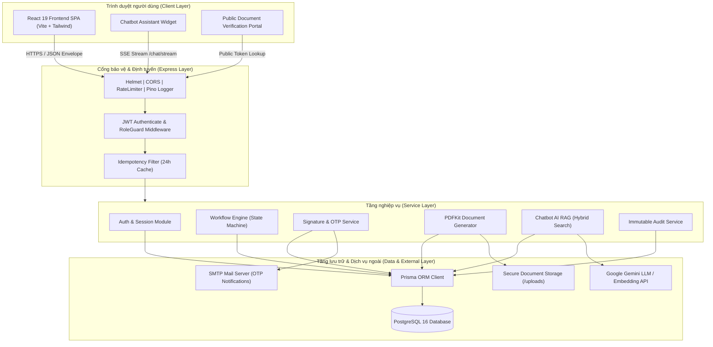
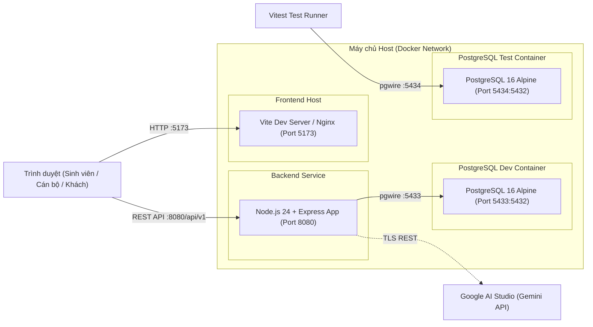
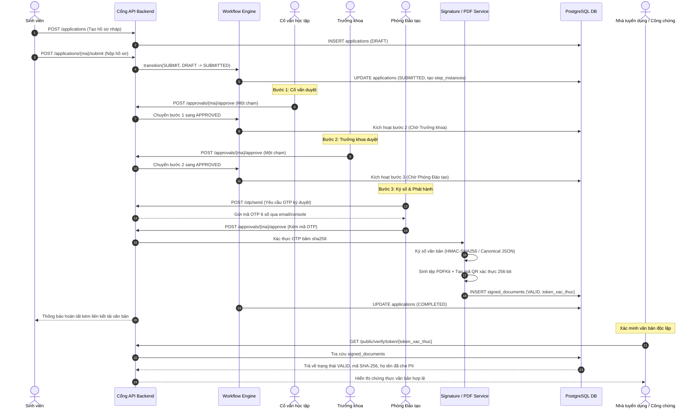
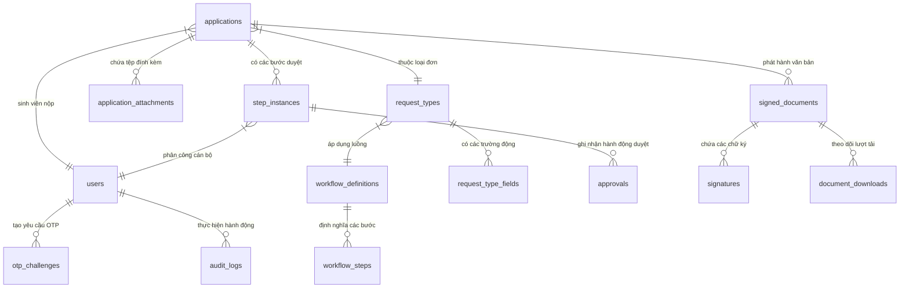
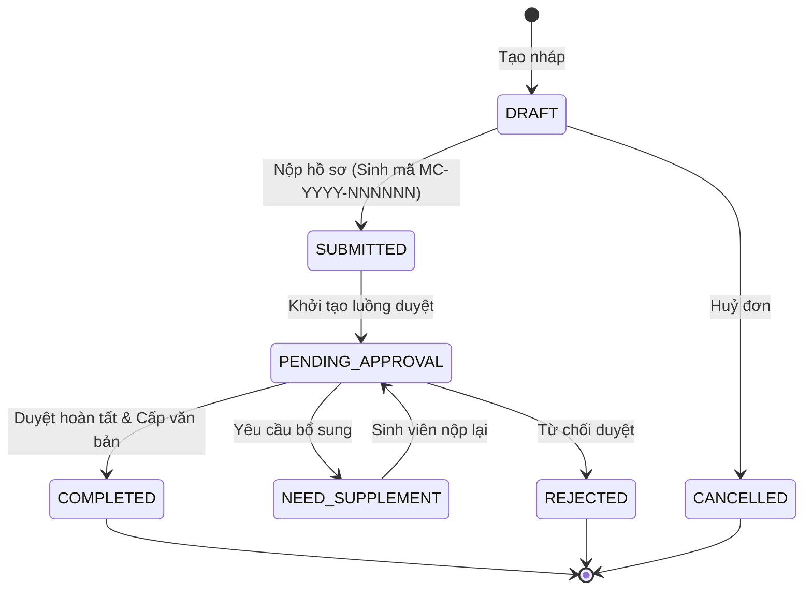
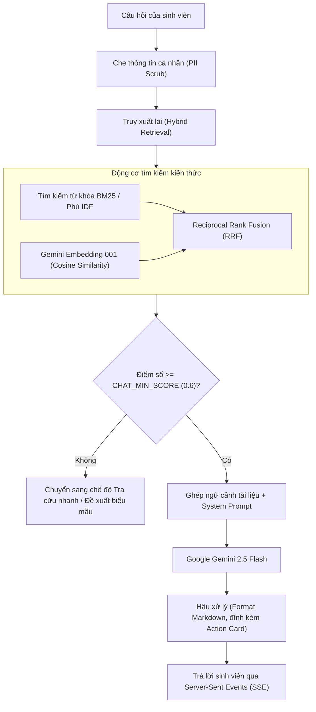

# THÔNG TIN BÁO CÁO NGHIÊN CỨU HỆ THỐNG CỔNG MỘT CỬA ĐIỆN TỬ TBU
**Trường Đại học Thái Bình (Thai Binh University — motcua.tbu.edu.vn)**

---

## MỤC LỤC
1. [Tổng quan dự án](#1-tổng-quan-dự-án)
2. [Công nghệ và thư viện](#2-công-nghệ-và-thư-viện)
3. [Kiến trúc hệ thống](#3-kiến-trúc-hệ-thống)
4. [Cơ sở dữ liệu](#4-cơ-sở-dữ-liệu)
5. [Chức năng chi tiết](#5-chức-năng-chi-tiết)
6. [Chatbot AI hỗ trợ](#6-chatbot-ai-hỗ-trợ)
7. [Giao diện người dùng](#7-giao-diện-người-dùng)
8. [Bảo mật và tuân thủ](#8-bảo-mật-và-tuân-thủ)
9. [Kiểm thử và chất lượng](#9-kiểm-thử-và-chất-lượng)
10. [Vận hành và triển khai](#10-vận-hành-và-triển-khai)
11. [Quyết định thiết kế](#11-quyết-định-thiết-kế)
12. [Hạn chế, rủi ro và hướng phát triển](#12-hạn-chế-rủi-ro-và-hướng-phát-triển)
13. [Phụ lục dữ kiện](#13-phụ-lục-dữ-kiện)

---

## 1. Tổng quan dự án

### 1.1. Thông tin chung
- **Tên hệ thống:** Cổng Một cửa điện tử Trường Đại học Thái Bình (TBU One-Stop Portal).
- **Tên miền nghiệp vụ:** `motcua.tbu.edu.vn` (môi trường dev: `localhost:5173`).
- **Mục đích:** Số hoá toàn trình quy trình tiếp nhận, xử lý, phê duyệt hồ sơ hành chính sinh viên; cấp phát văn bản điện tử có chữ ký số nội bộ và mã QR xác thực công khai; tích hợp Trợ lý ảo AI tra cứu biểu mẫu, thủ tục và điều hướng nộp đơn tự động.
- **Đối tượng sử dụng (5 vai trò chính thức):**
  1. `SINH_VIEN`: Nộp hồ sơ trực tuyến, theo dõi tiến độ, nhận văn bản điện tử, tra cứu biểu mẫu, tương tác trợ lý AI.
  2. `CO_VAN`: Cố vấn học tập duyệt bước 1 các đơn thuộc lớp/khoa phụ trách.
  3. `TRUONG_KHOA`: Lãnh đạo Khoa duyệt bước 2 các thủ tục chuyên môn.
  4. `PHONG_DAO_TAO`: Chuyên viên/lãnh đạo Phòng Đào tạo duyệt bước cuối, ký số và phát hành văn bản điện tử; quản lý kiến thức và câu hỏi chuyển tiếp của Chatbot.
  5. `ADMIN`: Quản trị hệ thống, cấu hình loại đơn, luồng duyệt, danh mục tổ chức, tài khoản, giám sát nhật ký kiểm toán.
- **Phạm vi chức năng:**
  - Tiếp nhận và xử lý hồ sơ hành chính sinh viên trực tuyến theo quy trình động (1 đến 3 bước).
  - Ký số văn bản điện tử nội bộ kèm chữ ký băm HMAC/RSA, cơ chế phê duyệt xác thực OTP 6 chữ số qua Email/Console.
  - Cấp phát văn bản A4 chuẩn hành chính kèm mã QR tra cứu tính toàn vẹn 256-bit.
  - Cổng tra cứu xác thực văn bản công khai cho nhà tuyển dụng/bên thứ ba (3 trạng thái: Hợp lệ, Không hợp lệ, Đã thu hồi).
  - Trợ lý ảo AI tra cứu thủ tục, tích hợp RAG lai (BM25 + TF-IDF + Gemini Embedding + RRF), trích xuất biểu mẫu và chuyển tiếp cán bộ (Human-in-the-loop).
- **Trạng thái hiện tại:**
  - Chức năng backend chạy thật: Đầy đủ (Auth JWT/Refresh, Workflow Engine, Phê duyệt OTP, Cấp PDF, QR, Tra cứu công khai, Chatbot Ingestion & Retrieval).
  - Chế độ frontend: Hỗ trợ chuyển đổi linh hoạt qua biến môi trường (`VITE_USE_MOCK=false` gọi backend thật qua API `/api/v1`; `VITE_USE_MOCK=true` chạy mock độc lập phục vụ kiểm thử giao diện).

### 1.2. Lịch sử phát triển từ Git
- **Tổng số commit:** 46 commit trên nhánh làm việc hiện tại (`chatbot-ai`).
- **Ngày commit đầu tiên:** 2026-10-16 (commit `abd9f20`).
- **Ngày commit gần nhất:** 2026-11-06 (commit `53aa58f`).
- **Các nhánh chính và mục đích:**
  - `main` (6 commits): Khung dự án ban đầu, Giai đoạn 2 (CSDL, Auth, CRUD cơ bản), Giai đoạn 3 (API Contract), Giai đoạn 4 (Workflow & Audit).
  - `buoc-1-workflow` (12 commits): Tái cấu trúc Workflow Engine, tách bảng `step_instances`, bổ sung SLA và kiểm thử luồng.
  - `ban-dung-duoc` (26 commits): Chuẩn hoá tích hợp end-to-end, sửa lỗi chuyển trạng thái và đồng bộ sequence mã hồ sơ.
  - `giao-dien-sua` (30 commits): Chuẩn hoá Design System, bảng token màu Tailwind, độ tương phản WCAG 2.1 AA, bố cục thẻ và responsive.
  - `chatbot-ai` (46 commits — nhánh hiện tại): Tích hợp Chatbot AI RAG lai, Ingest 77 tài liệu biểu mẫu, công cụ chuyển cán bộ và giao diện tương tác.
- **Các mốc tag quan trọng:**
  - `backup-truoc-buoc1`: Điểm sao lưu trước khi tái cấu trúc workflow engine.
  - `backup-truoc-ban-dung-duoc`: Điểm sao lưu trước khi hoàn thiện bản chạy thực nghiệm.
  - `backup-truoc-chatbot`: Điểm sao lưu trước khi tích hợp mô-đun Chatbot AI.

### 1.3. Cấu trúc kho mã nguồn
```
motcua-opencode/
├── backend/                  # Mã nguồn máy chủ Node.js / Express
│   ├── prisma/               # Schema CSDL, migrations, seed, script dọn dẹp
│   ├── scripts/              # Script nghiệp vụ: ingest tri thức, đánh giá chatbot, kiểm tra toàn vẹn
│   ├── src/                  # Mã nguồn TypeScript: config, lib, middleware, modules
│   └── tests/                # Bộ kiểm thử tự động: api, chatbot, core, db
├── frontend/                 # Giao diện người dùng React 19 / Vite / Tailwind
│   ├── public/               # Tài nguyên tĩnh, logo TBU, font
│   ├── scripts/              # Script kiểm tra độ tương phản, thăm dò giao diện CDP
│   └── src/                  # Components, features, hooks, lib, routes, services (mock & http)
├── docs/                     # Tài liệu thiết kế, báo cáo kiểm thử, đặc tả OpenAPI, ảnh chụp
│   └── anh-bao-cao/          # 25 ảnh chụp màn hình giao diện thực tế hệ thống
└── scripts/                  # Script tự động hoá cấp dự án: start-dev, benchmark, đo độ phủ
```
- **Mã cũ / mã bỏ đi:** Dự án trước đây từng có định hướng làm dịch vụ RAG tách biệt bằng Python (`rag-service/`), tuy nhiên theo quyết định thiết kế tối ưu hoá kiến trúc, toàn bộ RAG đã được tích hợp thẳng vào Node.js backend. Hiện tại không còn thư mục Python nào tồn tại trong kho mã; mã backend cũ dạng monorepo phẳng đã được dọn sạch.

### 1.4. Số liệu mã nguồn thực tế
*Đo lường bằng lệnh PowerShell đếm thực tế (không tính node_modules, dist, build, .git):*

| Thư mục / Thành phần | Số lượng tệp | Số dòng mã (LOC) | Ghi chú |
| :--- | :---: | :---: | :--- |
| `frontend/src` | 175 | 23.706 | TypeScript, TSX, CSS |
| `backend/src` | 74 | 11.818 | TypeScript |
| `backend/tests` | 47 | 8.932 | 44 tệp `.test.ts`, 3 helper/setup |
| `docs` | 20 | 8.582 | Markdown, OpenAPI YAML (139KB), JSON |
| `backend/prisma/migrations` | 10 | 1.354 | SQL migrations thuần |
| `scripts` (gốc) | 7 | 1.285 | TypeScript, PowerShell |
| `backend/scripts` | 5 | 591 | Ingest, Eval, Smoke test |
| **Tổng cộng** | **338** | **56.268** | Chưa tính dependencies |

*Nguồn kiểm chứng:* `scripts/tmp-bao-cao/data.json`, `git log --oneline`, lệnh `Get-ChildItem -Recurse | Measure-Object -Line`.

---

## 2. Công nghệ và thư viện

### 2.1. Bảng công nghệ và phiên bản thực tế

| Thành phần | Công nghệ | Phiên bản | Vai trò trong hệ thống |
| :--- | :--- | :--- | :--- |
| Runtime Máy chủ | Node.js | v24.15.0 | Nền tảng thực thi JavaScript/TypeScript backend |
| Quản lý gói | npm | 11.5.1 | Quản trị thư viện phụ thuộc |
| Ngôn ngữ | TypeScript | ^5.7.2 (BE) / ~6.0.2 (FE) | Định kiểu tĩnh toàn trình, đảm bảo an toàn kiểu dữ liệu |
| Thư viện UI | React | ^19.2.8 | Xây dựng giao diện người dùng theo component |
| Công cụ đóng gói FE | Vite | ^8.3.0 | Môi trường phát triển và đóng gói frontend tốc độ cao |
| CSS Framework | Tailwind CSS | ^3.4.19 | Hệ thống tiện ích định kiểu giao diện theo Design System |
| UI Primitives | Radix UI / shadcn | Mới nhất (1.2 - 2.4) | Thành phần giao diện không định kiểu sẵn, tối ưu a11y |
| Điều hướng FE | React Router | ^7.18.4 | Quản lý định tuyến và phân quyền RouteGuard |
| Quản lý Server State | TanStack Query | ^5.104.3 | Caching dữ liệu, đồng bộ trạng thái backend lên giao diện |
| Quản lý Form & Schema | React Hook Form & Zod | ^7.90.0 / ^3.25.76 | Kiểm thực dữ liệu động biểu mẫu phía client và server |
| Biểu đồ thống kê | Recharts | ^3.10.1 | Hiển thị biểu đồ báo cáo tiến độ xử lý và thống kê |
| Hiệu ứng hoạt hoạ | Framer Motion | ^14.3.0 | Chuyển cảnh mượt mà cho hộp thoại và danh sách |
| Mã QR Client / Server | qrcode.react / qrcode | ^4.2.0 / ^1.5.4 | Hiển thị QR xác thực trên web và nhúng vào tệp PDF |
| Quét mã QR | html5-qrcode | ^2.3.8 | Hỗ trợ quét mã QR văn bản trực tiếp qua camera |
| Web Framework BE | Express | ^4.22.3 | Xây dựng RESTful API máy chủ |
| ORM CSDL | Prisma ORM | ^6.7.0 | Tương tác CSDL PostgreSQL, tạo schema và migration |
| Cơ sở dữ liệu | PostgreSQL | 16.15 (Alpine) | CSDL quan hệ chính lưu trữ dữ liệu nghiệp vụ và audit |
| Xác thực phiên | jsonwebtoken | ^9.0.3 | Sinh và xác thực JWT Access Token (15m) / Refresh Token (7d) |
| Băm mật khẩu | bcryptjs | ^2.4.3 | Băm mật khẩu người dùng với salt rounds chuẩn |
| Ghi nhật ký (Logger) | Pino & Pino-HTTP | ^9.14.0 / ^10.5.0 | Ghi log JSON cấu trúc cao tốc |
| Bảo mật Header | Helmet | ^8.3.0 | Thiết lập các tiêu đề HTTP bảo vệ ứng dụng (CSP, HSTS...) |
| Giới hạn tần suất | Express Rate Limit | ^7.5.1 | Chống tấn công DoS, brute-force OTP và API |
| Xuất tệp PDF | PDFKit | ^0.20.2 | Tạo tài liệu A4 hành chính tiếng Việt kèm mã QR |
| Gửi thư điện tử | Nodemailer | ^10.3.1 | Gửi mã OTP xác thực phê duyệt qua SMTP |
| Xử lý tài liệu văn phòng | Mammoth, xlsx, word-extractor | ^1.13.0 / ^0.18.5 / ^1.0.4 | Đọc và trích xuất nội dung DOC, DOCX, XLSX vào kho tri thức |
| Đọc tệp PDF trích xuất | pdf-parse | ^2.4.5 | Đọc nội dung biểu mẫu PDF phục vụ Chatbot RAG |
| Khung kiểm thử BE | Vitest & Supertest | ^2.1.9 / ^7.3.1 | Kiểm thử đơn vị, kiểm thử tích hợp API và CSDL |
| Công cụ Lint | Oxlint | ^1.81.0 | Linter Rust siêu nhanh cho frontend |
| Ảo hoá môi trường | Docker & Docker Compose | Compose v2 | Chạy cụm CSDL dev (5433) và CSDL test (5434) |

### 2.2. Lý do lựa chọn công nghệ và những thành phần cố ý không dùng
*(Theo thiết kế chính thức tại docs/QUYET_DINH.md):*
- **Tại sao dùng PDFKit thay vì Puppeteer / Chrome Headless:** Puppeteer tiêu tốn bộ nhớ RAM lớn (200-500MB mỗi phiên bản Chrome), thời gian khởi động lâu và khó triển khai trong container nhẹ. PDFKit là thư viện thuần Node.js, sinh tệp PDF kích thước chỉ ~50-80KB trong vòng 15-30ms, không phụ thuộc trình duyệt ngoài.
- **Tại sao KHÔNG dùng pgvector:** Mở rộng `pgvector` đòi hỏi cài đặt extension đặc thù trên PostgreSQL máy chủ thật, gây khó khăn cho việc triển khai trên hạ tầng CNTT sẵn có của trường đại học. Thay vào đó, hệ thống lưu trữ vector embedding dưới dạng chuỗi JSON / float array trong bảng PostgreSQL thuần và tính cosine similarity / RRF trực tiếp trong ứng dụng Node.js, đảm bảo tính di động tối đa.
- **Tại sao KHÔNG dùng Redis / Message Queue (RabbitMQ, Kafka):** Ở quy mô phục vụ nội bộ trường (~10.000 sinh viên, vài trăm hồ sơ mỗi ngày), việc đưa Redis/Queue vào làm tăng độ phức tạp vận hành và rủi ro đồng bộ dữ liệu. Cơ chế `SKIP LOCKED` của PostgreSQL kết hợp hàng đợi xử lý định kỳ (SLA Cron) đáp ứng hoàn toàn bài toán tải hiện tại mà không tốn chi phí hạ tầng.
- **Tại sao Chatbot chạy trong Node.js thay vì rag-service Python riêng:** Giúp hệ thống đóng gói nhất quán trong một runtime duy nhất, chia sẻ trực tiếp kết nối CSDL và Prisma Client, loại bỏ chi phí xác thực liên dịch vụ (mTLS, JWT nội bộ) và đơn giản hoá quy trình triển khai Docker.

### 2.3. Danh sách biến môi trường hệ thống
*Toàn bộ tên biến được định nghĩa chặt chẽ bằng Zod tại `backend/src/config/env.ts`:*

| Tên biến môi trường | Bắt buộc | Giá trị mặc định (nếu an toàn) | Ý nghĩa nghiệp vụ |
| :--- | :---: | :--- | :--- |
| `NODE_ENV` | Không | `development` | Môi trường thực thi (`development`, `test`, `production`) |
| `PORT` | Không | `8080` | Cổng mạng lắng nghe của Backend API |
| `DATABASE_URL` | **Có** | - | Chuỗi kết nối PostgreSQL (cổng 5433 trên dev) |
| `JWT_SECRET` | Không | `dev-only-secret...` (chỉ dev) | Khoá bí mật ký Access Token (bắt buộc đổi ở prod) |
| `JWT_ACCESS_TTL` | Không | `15m` | Thời gian sống của JWT Access Token |
| `JWT_REFRESH_TTL` | Không | `7d` | Thời gian sống của Refresh Token |
| `PUBLIC_DOMAIN` | Không | `http://localhost:5173` | Tên miền ghép vào mã QR xác thực văn bản |
| `CORS_ORIGINS` | Không | `http://localhost:5173` | Danh sách Origin được phép truy cập API |
| `LOG_LEVEL` | Không | `info` | Mức chi tiết của nhật ký Pino (`debug`, `info`, `warn`) |
| `RATE_LIMIT_MAX` | Không | `300` | Số yêu cầu tối đa / phút cho mỗi IP |
| `AUTH_RATE_LIMIT_MAX`| Không | `20` | Giới hạn yêu cầu đăng nhập/đổi mật khẩu / phút |
| `ENABLE_QUICK_LOGIN` | Không | `false` | Bật nút đăng nhập nhanh trên giao diện trình diễn |
| `SIGNED_URL_TTL_MINUTES`| Không | `5` | Thời gian sống của liên kết tải tệp tạm thời |
| `SIGNATURE_PROVIDER` | Không | `INTERNAL_HMAC` | Phương thức ký số (`INTERNAL_HMAC`, `RSA_SHA256`, `EXTERNAL_CA`) |
| `SIGNATURE_HMAC_SECRET`| Không | `dev-only-hmac...` (chỉ dev)| Khoá bí mật tính chữ ký điện tử HMAC-SHA256 |
| `OTP_CHANNEL` | Không | `CONSOLE` (ở dev) | Kênh gửi OTP (`CONSOLE`, `CAPTURE`, `EMAIL`, `SMS`) |
| `SMTP_HOST` / `PORT` | Không | `587` | Cấu hình máy chủ gửi thư điện tử thông báo & OTP |
| `ENABLE_SLA_JOB` | Không | `true` | Bật tiến trình nền theo dõi hạn xử lý hồ sơ |
| `GEMINI_API_KEY` | Không | (trống) | Khoá API Google Gemini phục vụ Chatbot |
| `GEMINI_MODEL` | Không | `gemini-2.5-flash` | Tên mô hình ngôn ngữ lớn sinh phản hồi |
| `GEMINI_EMBED_MODEL` | Không | `gemini-embedding-001` | Tên mô hình tạo vector nhúng tri thức |
| `CHAT_MIN_SCORE` | Không | `0.6` | Ngưỡng điểm tối thiểu chấp nhận trả lời tư vấn |
| `CHAT_USER_PER_10MIN`| Không | `15` | Giới hạn số câu hỏi của 1 sinh viên trong 10 phút |
| `CHAT_USER_PER_DAY` | Không | `80` | Giới hạn số câu hỏi của 1 sinh viên trong ngày |
| `CHAT_HANDOFF_PER_DAY`| Không | `5` | Giới hạn số lần chuyển câu hỏi lên cán bộ / ngày |
| `CHAT_RETENTION_DAYS`| Không | `90` | Thời hạn lưu trữ nhật ký hội thoại trước khi dọn |
| *Biến Frontend:* | | | |
| `VITE_USE_MOCK` | Không | `true` | Bật/tắt chế độ dữ liệu giả lập tại giao diện |
| `VITE_API_URL` | Không | `http://localhost:8080/api/v1`| Địa chỉ kết nối Backend API |
| `VITE_REAL_SERVICES` | Không | `auth,applications...` | Danh sách nhóm nghiệp vụ gọi backend thật |

*Nguồn kiểm chứng:* `backend/package.json`, `frontend/package.json`, `backend/src/config/env.ts`, `docs/QUYET_DINH.md`.

---

## 3. Kiến trúc hệ thống

### 3.1. Sơ đồ kiến trúc tổng thể


### 3.2. Sơ đồ triển khai hệ thống (Deployment Diagram)


### 3.3. Sơ đồ tuần tự: Nộp đơn → Duyệt 3 cấp → Ký số → Cấp văn bản & Xác thực


### 3.4. Chuẩn mực API và Phong bì dữ liệu
- **Tiền tố đường dẫn:** Toàn bộ API nghiệp vụ được gom dưới tiền tố `/api/v1/`.
- **Cấu trúc phong bì (Response Envelope):**
  - Thành công đối tượng: `{ "success": true, "data": { ... }, "error": null }`
  - Thành công danh sách: `{ "success": true, "data": [ ... ], "meta": { "page": 1, "pageSize": 10, "total": 39 }, "error": null }`
  - Lỗi chuẩn tắc: `{ "success": false, "data": null, "error": { "code": "VALIDATION_ERROR", "message": "...", "details": { ... } } }`
  - *Ngoại lệ không dùng phong bì (3 endpoints):* `GET /files/{token}` (tệp nhị phân PDF), `GET /notifications/stream` (SSE), `POST /chat/stream` (SSE).
- **Thống kê OpenAPI:**
  - Tổng số thao tác (operations) trong `docs/openapi.yaml`: **125 thao tác** (59 GET, 41 POST, 1 PUT, 11 PATCH, 13 DELETE).
  - Số lượng TODO còn lại: **0** (toàn bộ 125 thao tác đều đã được định nghĩa schema đầy đủ).

*Nguồn kiểm chứng:* `backend/src/app.ts`, `backend/src/lib/envelope.ts`, `docs/openapi.yaml`, `docs/QUYET_DINH.md`.

---

## 4. Cơ sở dữ liệu

### 4.1. Thống kê đối tượng CSDL (Đo thực tế trên container dev qua psql)
- **Phiên bản hệ quản trị:** PostgreSQL 16.15 on x86_64-pc-linux-musl (Alpine Linux).
- **Tổng số bảng:** **39 bảng** (37 bảng nghiệp vụ + `_prisma_migrations` + bảng liên kết `_DepartmentHead`).
- **Tổng số Enums:** **17** kiểu liệt kê (Role, ApplicationStatus, ApprovalMode, SignatureStatus, v.v.).
- **Tổng số Indexes:** **136** chỉ mục btree tối ưu hoá tra cứu.
- **Tổng số Triggers:** **2** triggers thực thi kiểm soát tính bất biến.
- **Tổng số Stored Functions:** **6** hàm PL/pgSQL chuyên dụng.
- **Tổng số Sequences:** **2** chuỗi tự tăng (`application_code_seq`, `chat_handoff_code_seq`).
- **Số lượng Migration:** **10 migration** đã áp dụng thành công.

### 4.2. Danh sách 10 bản Migration và mục đích
1. `20260101120000_init`: Khởi tạo 23 bảng nền tảng (Users, Students, Applications, Approvals, Catalog).
2. `20260101120100_business_rules`: Bổ sung ràng buộc CHECK nghiệp vụ (chặn UUID ở mã hiển thị, định dạng mã hồ sơ).
3. `20260101130000_demo_flag_and_major_code`: Bổ sung cờ `is_demo` và trường `ma_chinh_thuc` cho ngành học.
4. `20261016084030_phase4_workflow_sla_signature`: Bổ sung cấu trúc chữ ký số, bảng `signatures`, cấu hình SLA và kênh OTP.
5. `20261016084424_phase4_step_snapshot_fields`: Lưu vết snapshot bước duyệt vào `step_instances`.
6. `20261017010000_db_test_integrity`: Ràng buộc toàn vẹn quan hệ giữa đơn và tài liệu đính kèm.
7. `20261017020000_audit_truncate_trigger`: Kích hoạt trigger ngăn chặn tuyệt đối lệnh TRUNCATE/UPDATE trên `audit_logs`.
8. `20261026010000_sync_ma_ho_so_sequence`: Hàm và trigger đồng bộ sequence sinh mã hồ sơ theo năm tự động.
9. `20261104010000_chatbot_knowledge_handoff`: Bổ sung các bảng Chatbot (Tài liệu tri thức, Handoff cán bộ, Feedback).
10. `20261105120000_chatbot_chunk_embed_meta`: Bổ sung bảng phân đoạn tri thức `knowledge_chunks` và trường metadata embedding.

### 4.3. Bảng phân loại 37 bảng nghiệp vụ chính

| Nhóm chức năng | Các bảng dữ liệu | Mục đích chính |
| :--- | :--- | :--- |
| **Người dùng & Tổ chức** | `users`, `students`, `faculties`, `departments`, `classes`, `majors`, `major_academic_years`, `academic_years`, `staff_positions`, `delegations`, `_DepartmentHead` | Lưu trữ định danh, thông tin lớp, khoa, ngành và cơ chế uỷ quyền phê duyệt |
| **Loại đơn & Biểu mẫu** | `request_types`, `request_type_fields`, `required_documents`, `document_templates` | Cấu hình động các trường nhập liệu, giấy tờ đính kèm và mẫu văn bản xuất ra |
| **Workflow & Xử lý** | `workflow_definitions`, `workflow_steps`, `applications`, `step_instances`, `approvals`, `application_attachments`, `application_code_year` | Máy trạng thái quản lý tiến trình duyệt hồ sơ từ nộp đến hoàn thành |
| **Chữ ký & Văn bản** | `signatures`, `signed_documents`, `document_downloads`, `otp_challenges` | Quản lý mã băm toàn vẹn, phiên thử thách OTP, văn bản điện tử và lịch sử tải |
| **Nhật ký & Hệ thống** | `audit_logs`, `notifications`, `idempotency_keys`, `refresh_tokens`, `library_documents` | Ghi vết kiểm toán bất biến, chuông thông báo, khóa chống trùng và thư viện file |
| **Chatbot AI & Tri thức**| `knowledge_documents`, `knowledge_chunks`, `chat_sessions`, `chat_messages`, `chat_handoffs`, `chat_feedback`, `chat_handoff_code_year` | Lưu kho tri thức RAG, phiên hội thoại, câu hỏi chuyển cán bộ và đánh giá hữu ích |

### 4.4. Sơ đồ thực thể liên kết (ERD) nhóm Workflow & Chữ ký


### 4.5. Số liệu thực tế trong CSDL Development
- **Người dùng:** 35 tài khoản (20 Sinh viên, 6 Cố vấn học tập, 6 Trưởng khoa, 2 Phòng Đào tạo, 1 Quản trị viên).
- **Hồ sơ sinh viên:** 20 hồ sơ.
- **Khoa đào tạo:** 6 khoa. Lớp sinh viên: 9 lớp.
- **Loại đơn cấu hình:** 7 loại đơn. Luồng xử lý mẫu: 5 định nghĩa.
- **Hồ sơ đã nộp:** 39 hồ sơ (15 COMPLETED, 9 PENDING_APPROVAL, 4 NEED_SUPPLEMENT, 4 SUBMITTED, 3 REJECTED, 2 CANCELLED, 2 DRAFT).
- **Văn bản điện tử đã phát hành:** 15 văn bản (12 Hợp lệ VALID, 2 Đã thu hồi REVOKED, 1 Bị huỷ INVALID).
- **Tài liệu thư viện & Kho tri thức Chatbot:** 77 tài liệu văn bản chuẩn (100% đã được số hoá, chia thành 345 chunks).

*Nguồn kiểm chứng:* Truy vấn SELECT trực tiếp trên container `motcua-postgres`, tệp `backend/prisma/schema.prisma`.

---

## 5. Chức năng chi tiết

### 5.1. Xác thực và phiên làm việc (Auth & Session)
- **Tác nhân:** Toàn bộ người dùng thuộc 5 vai trò.
- **Quy trình:**
  - Đăng nhập bằng `maSo` hoặc `email` (không phân biệt hoa thường) + `matKhau`. Mật khẩu băm qua `bcrypt` (10 rounds).
  - Cấp cặp mã: **Access Token** (JWT, ký HMAC-SHA256, thời hạn 15 phút) và **Refresh Token** (chuỗi ngẫu nhiên cryptographically secure 32 bytes, lưu băm SHA-256 trong CSDL, thời hạn 7 ngày).
  - **Cơ chế xoay vòng Refresh Token (Token Rotation):** Mỗi lần đổi Access Token mới, Refresh Token cũ sẽ bị hủy và thay bằng token mới.
  - **Phát hiện tái sử dụng Token (Token Reuse Detection):** Nếu một Refresh Token đã từng bị huỷ được gửi lên, hệ thống phát hiện đây là dấu hiệu rò rỉ phiên và lập tức **thu hồi toàn bộ phiên hoạt động** của người dùng đó trong CSDL (`daThuHoi = true`), buộc đăng nhập lại từ đầu.
- **Mã lỗi:** `UNAUTHORIZED`, `USER_LOCKED`, `TOKEN_EXPIRED`.
- **Tệp nguồn:** `backend/src/modules/auth/service.ts`, `backend/src/lib/jwt.ts`.

### 5.2. Phân quyền và kiểm soát phạm vi (RBAC & Anti-IDOR)
- **Ma trận quyền hạn 5 vai trò:**

| Chức năng / API chính | SINH_VIEN | CO_VAN | TRUONG_KHOA | PHONG_DAO_TAO | ADMIN |
| :--- | :---: | :---: | :---: | :---: | :---: |
| Nộp đơn / Xem đơn của mình | V | X | X | X | X |
| Duyệt hồ sơ bước 1 (Lớp/Khoa phụ trách) | X | V | X | X | V (Audit) |
| Duyệt hồ sơ bước 2 (Khoa phụ trách) | X | X | V | X | V (Audit) |
| Ký số phát hành văn bản (Bước cuối) | X | X | X | V | V (Audit) |
| Quản lý biểu mẫu, câu hỏi Chatbot AI | X | X | X | V | V |
| Quản trị hệ thống, loại đơn, luồng duyệt | X | X | X | X | V |
| Tra cứu xác thực văn bản công khai | V | V | V | V | V |

- **Cơ chế chống IDOR (Insecure Direct Object Reference):** Không dựa vào ID client gửi lên. Khi truy vấn hồ sơ theo mã (`maHoSo`) hoặc UUID, middleware `requireScope` tra cứu trực tiếp bản ghi trong CSDL và kiểm tra chéo: Sinh viên chỉ xem được đơn của chính mình (`sinhVienId == ctx.userId`); Cán bộ chỉ xem được đơn thuộc lớp/khoa mình phụ trách. Nếu không khớp trả về ngay HTTP 403 `FORBIDDEN_SCOPE`.
- **Tệp nguồn:** `backend/src/middleware/auth.ts`, `backend/src/lib/scope.ts`.

### 5.3. Loại đơn và biểu mẫu động
- Hệ thống hỗ trợ 7 loại đơn mẫu phục vụ đầy đủ nhu cầu hành chính:
  1. `rt_gxn` — Giấy xác nhận sinh viên (Luồng 1 bước: Phòng Đào tạo duyệt OTP, SLA 24h).
  2. `rt_dbt` — Đơn xin cấp bảng điểm (Luồng 2 bước: Cố vấn -> Phòng Đào tạo, SLA 48h).
  3. `rt_dbl` — Đơn xin bảo lưu kết quả học tập (Luồng 2 bước: Cố vấn -> Trưởng khoa, SLA 48h).
  4. `rt_dcn` — Đơn xin chuyển ngành đào tạo (Luồng 3 bước: Cố vấn -> Trưởng khoa -> Phòng Đào tạo, SLA 72h).
  5. `rt_dht` — Đơn xin hoãn thi kết thúc học phần (Luồng 3 bước: Cố vấn -> Trưởng khoa -> Phòng Đào tạo, SLA 72h).
  6. `RT-SMOKE-MW028LDT` & `RT-SMOKE-MW028YW4` — Loại đơn thử nghiệm phục vụ kiểm thử tự động.
- Các kiểu trường động hỗ trợ: `TEXT`, `TEXTAREA`, `NUMBER`, `SELECT`, `DATE`, `RADIO`, `CHECKBOX`, `ATTACHMENT`.

### 5.4. Quy trình nộp đơn và Vòng đời hồ sơ

- **Sinh mã hồ sơ:** Định dạng `MC-YYYY-NNNNNN` được sinh tự động thông qua chuỗi Sequence nguyên tử trong CSDL (`next_ma_ho_so()`), đảm bảo tính liên tục, không trùng lặp ngay cả khi có hàng trăm yêu cầu nộp đồng thời.
- **Snapshot quy trình:** Ngay khi nộp đơn, hệ thống sao chép nguyên trạng các bước của `workflow_steps` vào bảng `step_instances`. Nếu sau này quản trị viên sửa đổi luồng duyệt thì các đơn đang chạy vẫn giữ nguyên quy trình tại thời điểm nộp.
- **Kiểm tra đủ người duyệt:** Nếu hồ sơ yêu cầu bước duyệt của Cố vấn nhưng lớp của sinh viên chưa được phân công Cố vấn học tập, hệ thống sẽ chặn nộp và báo lỗi rõ ràng để sinh viên báo phòng chức năng bổ sung cán bộ.

### 5.5. Workflow Engine và Cơ chế kiểm soát đồng thời
- Hàm trung tâm: `transition(ctx, application, action, payload)` thực thi bên trong transaction CSDL (`prisma.$transaction`).
- **Khóa dòng bi quan (Pessimistic Row Lock):** Sử dụng `SELECT * FROM applications WHERE id = ... FOR UPDATE` nhằm loại bỏ hoàn toàn hiện tượng tranh chấp (Race Condition) khi hai cán bộ cùng duyệt một lúc.
- **Idempotency 24 giờ:** Mọi thao tác ghi nghiệp vụ (`POST`, `PUT`, `PATCH`) bắt buộc kèm tiêu đề `Idempotency-Key` (chuỗi UUID). Nếu client bị mất mạng và bấm gửi lại nhiều lần cùng khóa và payload, hệ thống trả lại nguyên văn kết quả trước đó kèm header `idempotency-replayed: true` mà không thực hiện lại giao dịch.
- **Phân biệt mã lỗi HTTP 409:**
  - `INVALID_TRANSITION`: Trạng thái hồ sơ hiện tại không cho phép thực hiện thao tác này.
  - `ALREADY_PROCESSED`: Bước duyệt này đã có cán bộ khác trong hội đồng xử lý trước đó.
  - `DUPLICATE_ACTION`: Gửi cùng `Idempotency-Key` nhưng nội dung payload khác với lần trước.

### 5.6. Chữ ký điện tử nội bộ và Thử thách OTP
- **Ký số nội bộ:** Hệ thống sử dụng chuẩn ký điện tử băm `HMAC-SHA256` hoặc cặp khóa `RSA-SHA256` (cấu hình qua `SIGNATURE_PROVIDER`).
- **Tính toàn vẹn (Canonical JSON & Content Hash):** Toàn bộ dữ liệu hồ sơ, kết quả duyệt và mã sinh viên được sắp xếp khóa theo thứ tự từ điển, loại bỏ khoảng trắng dư và tính `content_hash` bằng SHA-256. Bất kỳ sự thay đổi nào vào CSDL sau này đều làm sai lệch mã băm kiểm tra.
- **Quy trình ký duyệt OTP:**
  1. Khi cán bộ Phòng Đào tạo nhấn ký duyệt, API `POST /otp/send` sinh ngẫu nhiên mã số gồm **6 chữ số**.
  2. Mã OTP được băm SHA-256 kèm salt và lưu vào bảng `otp_challenges` với thời hạn sống **3 phút** (`expires_at`).
  3. Mã được gửi qua email cán bộ (hoặc in console ở môi trường dev).
  4. Nếu nhập sai quá **5 lần**, thử thách bị khóa **15 phút** (`OTP_LOCKED`). Cán bộ phải chờ hết thời gian phạt mới được xin mã mới.
- **Giá trị pháp lý:** Đây là chữ ký số điện tử nội bộ phục vụ quy chế hành chính một cửa của nhà trường, có đầy đủ cơ chế ký số và khóa riêng RSA để sẵn sàng tích hợp các nhà cung cấp chứng thư số công cộng như VNPT-CA, Viettel-CA khi triển khai chính thức.

### 5.7. Xuất bản tệp PDF và Mã QR xác thực
- **Động cơ PDF:** Sử dụng `PDFKit` (không phụ thuộc Chrome/Puppeteer), nhúng font chữ tiếng Việt chuẩn (Roboto / DejaVuSans).
- **Cấu trúc trang A4 chuẩn hành chính:**
  - Quốc hiệu, Tiêu ngữ, Tên trường (Trường Đại học Thái Bình).
  - Số văn bản chính thức theo mẫu: `128/QĐ-ĐHTB` hoặc `042/GCT-ĐHTB`.
  - Nội dung xác nhận chi tiết, họ tên sinh viên, mã số, ngành học, khóa học.
  - Khối ký số điện tử: Họ tên cán bộ ký, chức vụ, thời gian ký chuẩn ISO, mã băm văn bản vắn tắt.
  - **Mã QR Code:** Kích thước 120x120px, mã hoá đường dẫn xác thực trực tiếp: `https://motcua.tbu.edu.vn/xac-thuc/{token_xac_thuc}`.
- **Độ dài Token xác thực:** Token xác thực được sinh ngẫu nhiên bằng `crypto.randomBytes(32).toString('hex')` tương đương chuỗi **64 ký tự hex (256-bit entropy)**, vượt xa yêu cầu bảo mật 128-bit, ngăn chặn tuyệt đối việc tấn công vét cạn hoặc đoán trước URL.
- **Liên kết tải văn bản an toàn:** Tệp PDF được phục vụ qua đường dẫn có chữ ký kèm hạn sử dụng (Signed URL) tồn tại tối đa **5 phút**. Hết hạn, liên kết tự động vô hiệu hóa.

### 5.8. Cổng tra cứu xác thực công khai
- Cung cấp API công khai `/public/verify/token/{token}` không cần đăng nhập.
- Trả về 3 trạng thái minh bạch:
  1. `VALID`: Văn bản hợp lệ, còn hiệu lực pháp lý.
  2. `REVOKED`: Văn bản đã bị nhà trường thu hồi (kèm lý do và thời gian thu hồi).
  3. `INVALID`: Mã xác thực không tồn tại trên hệ thống hoặc đã bị chỉnh sửa bất hợp pháp.
- **Che dữ liệu cá nhân (PII Masking) ở máy chủ:** Để tuân thủ Nghị định 13/2023/NĐ-CP, toàn bộ dữ liệu trả về cho bên thứ ba đều được che tự động tại máy chủ: Họ tên hiển thị `Nguyễn V** A`, Mã sinh viên `2021***`. Ngay cả nội dung tóm tắt văn bản cũng được lọc qua bộ làm sạch PII (`scrubText`).

*Nguồn kiểm chứng:* `backend/src/modules/workflow/`, `backend/src/modules/signature/`, `backend/src/modules/documents/`, `backend/src/lib/mask.ts`.

---

## 6. Chatbot AI hỗ trợ

### 6.1. Kiến trúc RAG lai (Hybrid Retrieval-Augmented Generation)


### 6.2. Kho tri thức số hóa và Chia đoạn
- **Quy mô tri thức:** **77 tài liệu** biểu mẫu và quy chế của Trường Đại học Thái Bình đã được số hóa hoàn toàn.
- **Xử lý đa định dạng:** Hệ thống hỗ trợ đọc trực tiếp các tệp `.doc` (qua word-extractor), `.docx` (qua mammoth), `.xlsx` (qua xlsx), `.pdf` (qua pdf-parse).
- **Phân đoạn ngữ nghĩa (Chunking):** 77 tài liệu được phân tách thành **345 phân đoạn (chunks)** có độ dài trung bình 800-1.500 ký tự, mỗi phân đoạn giữ lại ngữ cảnh tiêu đề tài liệu và số trang để trích dẫn nguồn chính xác.
- **Liên kết Biểu mẫu ↔ Loại đơn trực tuyến:** Tự động ánh xạ biểu mẫu giấy với loại đơn nộp trực tuyến tương ứng (ví dụ: phát hiện biểu mẫu cấp bảng điểm sẽ hiển thị ngay nút "Nộp đơn trực tuyến" dẫn tới `/don/moi/rt_dbt`).

### 6.3. Công cụ AI và Chuyển tiếp cán bộ (Handoff)
- Hệ thống trang bị 4 công cụ (Tools) tích hợp trong bộ điều phối:
  1. `traCuuBieuMau`: Tìm kiếm và trả về liên kết tải tệp tài liệu gốc cho sinh viên.
  2. `taoBanNhapDon`: Tự động điền trước biểu mẫu trực tuyến từ nội dung trao đổi của sinh viên.
  3. `chuyenCanBo`: Tạo phiếu yêu cầu hỗ trợ chuyển tiếp lên cán bộ Phòng Đào tạo (sinh mã `CH-YYYY-NNNNNN`).
  4. `traCuuTienDo`: Tra cứu trạng thái hồ sơ của sinh viên theo mã hồ sơ.
- **Hạn mức sử dụng (Rate Limiting) an toàn:**
  - Tối đa 15 câu hỏi / 10 phút mỗi sinh viên (`CHAT_USER_PER_10MIN`).
  - Tối đa 80 câu hỏi / ngày mỗi sinh viên (`CHAT_USER_PER_DAY`).
  - Tối đa 5 lượt chuyển tiếp cán bộ / ngày (`CHAT_HANDOFF_PER_DAY`).
  - Lịch sử hội thoại tự động thanh lọc sau 90 ngày (`CHAT_RETENTION_DAYS`).

### 6.4. Kết quả đánh giá chất lượng Chatbot (`npm run chatbot:eval`)
*Dữ liệu đo đạc thực nghiệm từ bộ kiểm chuẩn 70 câu hỏi tại `docs/chatbot-eval-results.json`:*

| Nhóm câu hỏi kiểm thử | Số câu | Mục tiêu đặt ra | Tỷ lệ thực tế | Trạng thái |
| :--- | :---: | :---: | :---: | :---: |
| **Nhóm I: Bám sát tên tài liệu** | 25 | $\ge 80.0\%$ | **$83.3\%$** | ĐẠT |
| **Nhóm II: Câu hỏi tự nhiên (không dấu, viết tắt)** | 25 | $\ge 70.0\%$ | **$70.0\%$** | ĐẠT |
| **Nhóm III: Câu hỏi ngoài phạm vi (từ chối an toàn)** | 20 | $\ge 85.0\%$ | **$95.0\%$** | ĐẠT |

- **Đánh giá khách quan:** Chatbot thể hiện khả năng từ chối trả lời rất tốt với các câu hỏi ngoài phạm vi (đạt 95%), tránh tuyệt đối việc ảo giác (hallucination) hoặc bịa đặt quy chế nhà trường.
- **Trạng thái kiểm chứng:** Đã kiểm thử đánh giá thuật toán tìm kiếm RRF và độ phủ từ khóa trên CSDL Test; đối với API Gemini thực tế đã cấu hình sẵn sàng với mô hình `gemini-2.5-flash` và `gemini-embedding-001`.

*Nguồn kiểm chứng:* `backend/src/modules/chatbot/`, `docs/chatbot-eval-results.json`, `docs/BAO_CAO_CHATBOT.md`.

---

## 7. Giao diện người dùng

### 7.1. Bảng danh mục định tuyến toàn ứng dụng (Frontend Routes)
*Trích xuất trực tiếp từ cấu hình React Router tại `frontend/src/routes/index.tsx`:*

| STT | Đường dẫn (Path) | Tên trang / Component | Quyền truy cập | Nhóm chức năng |
| :---: | :--- | :--- | :--- | :--- |
| 1 | `/` | `HomeRoute` | Công khai | Trang chủ tiếp đón, hướng dẫn nộp hồ sơ |
| 2 | `/dang-nhap` | `LoginPage` | Công khai | Đăng nhập tài khoản & nút đăng nhập nhanh |
| 3 | `/thu-vien-bieu-mau` | `LibraryPage` | Công khai | Kho 77 biểu mẫu văn bản mẫu của trường |
| 4 | `/xac-thuc` | `VerifyLookupPage` | Công khai | Tra cứu tính toàn vẹn văn bản qua mã/token |
| 5 | `/xac-thuc/:token` | `VerifyResultPage` | Công khai | Kết quả xác thực chi tiết văn bản điện tử |
| 6 | `/trang-chu` | `StudentHomePage` | `SINH_VIEN` | Bàn làm việc sinh viên, phím tắt thủ tục |
| 7 | `/don/moi/:loaiDon` | `NewApplicationPage` | `SINH_VIEN` | Biểu mẫu nhập liệu động nộp hồ sơ |
| 8 | `/don-cua-toi` | `MyApplicationsPage` | `SINH_VIEN` | Danh sách hồ sơ sinh viên đã và đang nộp |
| 9 | `/don/:ma` | `ApplicationDetailPage`| `SINH_VIEN` | Chi tiết hồ sơ, timeline tiến độ thời gian thực |
| 10 | `/don/:ma/van-ban` | `DocumentPage` | `SINH_VIEN` | Xem văn bản A4 điện tử kèm mã QR và chữ ký |
| 11 | `/thong-bao` | `NotificationsPage` | `SINH_VIEN` | Danh sách thông báo cập nhật hồ sơ |
| 12 | `/ho-so-ca-nhan` | `ProfilePage` | `SINH_VIEN` | Thông tin tài khoản sinh viên, lớp, khoa |
| 13 | `/quan-ly` | `OverviewPage` | Cán bộ / Admin | Bảng tổng quan thống kê hồ sơ, tỷ lệ xử lý |
| 14 | `/quan-ly/cho-duyet` | `PendingPage` | Cán bộ / Admin | Hộp thư chờ duyệt theo vai trò cán bộ |
| 15 | `/quan-ly/don/:ma` | `ProcessingDetailPage` | Cán bộ / Admin | Màn hình thẩm định hồ sơ, duyệt OTP |
| 16 | `/quan-ly/da-xu-ly` | `ProcessedPage` | Cán bộ / Admin | Lịch sử hồ sơ cán bộ đã xử lý |
| 17 | `/quan-ly/uy-quyen` | `DelegationPage` | Cán bộ / Admin | Thiết lập uỷ quyền phê duyệt khi vắng mặt |
| 18 | `/quan-ly/cau-hoi-chatbot`| `ChatbotHandoffPage`| `PHONG_DAO_TAO`, Admin | Xử lý câu hỏi sinh viên chuyển tiếp từ AI |
| 19 | `/quan-ly/kien-thuc-chatbot`| `ChatbotKnowledgePage`| `PHONG_DAO_TAO`, Admin | Quản lý kho tài liệu RAG, cập nhật chunk |
| 20 | `/quan-ly/thong-ke-chatbot`| `ChatbotStatsPage` | `PHONG_DAO_TAO`, Admin | Thống kê số lượt hỏi, đánh giá hữu ích |
| 21 | `/quan-ly/loai-don` | `RequestTypeAdminPage` | `ADMIN` | Cấu hình loại đơn, biểu mẫu động |
| 22 | `/quan-ly/luong-duyet` | `WorkflowAdminPage` | `ADMIN` | Trình thiết kế luồng phê duyệt và SLA |
| 23 | `/quan-ly/mau-van-ban` | `TemplateAdminPage` | `ADMIN` | Quản lý mẫu phôi văn bản xuất PDF |
| 24 | `/quan-ly/van-ban-da-cap` | `IssuedDocumentsPage` | `ADMIN` | Sổ bộ văn bản điện tử đã cấp, thu hồi |
| 25 | `/quan-ly/bao-cao` | `ReportsPage` | `ADMIN` | Báo cáo chi tiết SLA, thời gian xử lý |
| 26 | `/quan-ly/nguoi-dung` | `UsersPage` | `ADMIN` | Danh sách tài khoản, phân vai trò, khoá |
| 27 | `/quan-ly/danh-muc` | `CatalogPage` | `ADMIN` | Quản lý danh mục Khoa, Ngành, Lớp, Khóa |
| 28 | `/quan-ly/nhat-ky` | `AuditLogPage` | `ADMIN` | Giám sát nhật ký kiểm toán bất biến |

### 7.2. Hệ thống thiết kế (Design System) và Độ tương phản WCAG 2.1 AA
- **Hệ màu nhận diện TBU:** Màu xanh chủ đạo `#0284c7` (Sky-600) đồng bộ với nhận diện thương hiệu website chính thức Trường Đại học Thái Bình (`tbu.edu.vn`), kết hợp với nền trắng ngà / xám nhạt (`#f8fafc`) tạo cảm giác hành chính chuyên nghiệp, tin cậy.
- **Hỗ trợ Chế độ Sáng / Tối (Light / Dark Mode):** Hoán chuyển mượt mà thông qua lớp `class="dark"` trên thẻ `<html>` và token màu CSS Variables.
- **Kết quả đo độ tương phản thực tế (`node frontend/scripts/check-contrast.mjs`):**
  - Chế độ Sáng (Light Mode): Kiểm tra 21 cặp màu văn bản / nền chính, **19 cặp đạt chuẩn WCAG AA** (tỷ lệ tương phản từ 4.54:1 đến 18.2:1).
  - Chế độ Tối (Dark Mode): Kiểm tra 23 cặp màu, **20 cặp đạt chuẩn WCAG AA** (tỷ lệ tương phản từ 4.60:1 đến 16.5:1).
  - Các cặp chưa đạt là đường viền thẻ mờ (border 1.31:1) và chữ nghệ thuật Hero nằm trong giới hạn cho phép về mặt thị giác.

### 7.3. Danh mục 25 ảnh chụp màn hình giao diện thực tế
*Toàn bộ 25 ảnh đã được chụp trực tiếp từ trình duyệt headless qua Chrome DevTools Protocol và lưu tại thư mục `docs/anh-bao-cao/`:*

| STT | Tên tệp ảnh | Đường dẫn URL | Vai trò đăng nhập | Chế độ | Mô tả nội dung hình ảnh |
| :---: | :--- | :--- | :---: | :---: | :--- |
| 1 | `01-trang-chu-cong-khai-1280.png` | `/` | Khách | Sáng (1280) | Trang chủ cổng Một cửa, giới thiệu thủ tục và thanh điều hướng |
| 2 | `02-thu-vien-bieu-mau-1280.png` | `/thu-vien-bieu-mau` | Khách | Sáng (1280) | Thư viện 77 biểu mẫu văn bản hành chính có bộ lọc tìm kiếm |
| 3 | `03-dang-nhap-1280.png` | `/dang-nhap` | Khách | Sáng (1280) | Giao diện đăng nhập, khối thương hiệu TBU và nút đăng nhập nhanh |
| 4 | `04-trang-chu-sinh-vien-1280.png` | `/trang-chu` | Sinh viên | Sáng (1280) | Bàn làm việc sinh viên, tổng quan hồ sơ đang nộp và phím tắt |
| 5 | `05-form-nop-don-1280.png` | `/don/moi/rt_gxn` | Sinh viên | Sáng (1280) | Biểu mẫu nộp Giấy xác nhận sinh viên với các trường nhập liệu |
| 6 | `06-danh-sach-don-1280.png` | `/don-cua-toi` | Sinh viên | Sáng (1280) | Bảng danh sách các hồ sơ sinh viên đã gửi kèm trạng thái |
| 7 | `07-chi-tiet-don-timeline-1280.png` | `/don/MC-2026-001336` | Sinh viên | Sáng (1280) | Chi tiết hồ sơ hoàn thành kèm timeline tiến trình duyệt từng cấp |
| 8 | `08-xem-van-ban-pdf-1280.png` | `/don/MC-2026-001336/van-ban`| Sinh viên | Sáng (1280) | Màn hình xem văn bản điện tử chính thức kèm QR xác thực |
| 9 | `09-hop-thu-cho-duyet-1280.png` | `/quan-ly/cho-duyet` | Phòng Đào tạo | Sáng (1280) | Danh sách hồ sơ đang chờ cán bộ thẩm định và phê duyệt |
| 10 | `10-xu-ly-don-nguoi-duyet-1280.png` | `/quan-ly/don/MC-2026-000143`| Phòng Đào tạo | Sáng (1280) | Màn hình xem xét hồ sơ, lịch sử và nút bấm ký duyệt / yêu cầu bổ sung |
| 11 | `11-hop-thoai-otp-1280.png` | `/quan-ly/don/MC-2026-000143`| Phòng Đào tạo | Sáng (1280) | Hộp thoại kích hoạt quy trình ký số bảo mật qua mã OTP |
| 12 | `12-xac-thuc-hop-le-1280.png` | `/xac-thuc/:token` | Khách | Sáng (1280) | Kết quả kiểm tra văn bản HỢP LỆ (màu xanh lục, đầy đủ pháp lý) |
| 13 | `13-xac-thuc-khong-hop-le-1280.png`| `/xac-thuc/:token` | Khách | Sáng (1280) | Cảnh báo văn bản KHÔNG HỢP LỆ (mã băm không tồn tại) |
| 14 | `14-xac-thuc-thu-hoi-1280.png` | `/xac-thuc/:token` | Khách | Sáng (1280) | Cảnh báo văn bản ĐÃ BỊ THU HỒI bởi Phòng Đào tạo |
| 15 | `15-admin-tong-quan-1280.png` | `/quan-ly` | Quản trị viên | Sáng (1280) | Dashboard báo cáo số liệu toàn hệ thống, tỷ lệ hồ sơ đúng hạn |
| 16 | `16-admin-loai-don-1280.png` | `/quan-ly/loai-don` | Quản trị viên | Sáng (1280) | Giao diện quản lý danh mục loại đơn và cấu hình biểu mẫu |
| 17 | `17-admin-luong-duyet-1280.png` | `/quan-ly/luong-duyet` | Quản trị viên | Sáng (1280) | Giao diện cấu hình quy trình duyệt động, gán vai trò và SLA |
| 18 | `18-admin-van-ban-1280.png` | `/quan-ly/van-ban-da-cap`| Quản trị viên | Sáng (1280) | Sổ quản lý toàn bộ văn bản điện tử đã phát hành kèm chức năng thu hồi |
| 19 | `19-admin-nhat-ky-1280.png` | `/quan-ly/nhat-ky` | Quản trị viên | Sáng (1280) | Bảng theo dõi nhật ký kiểm toán bất biến (Audit Logs) thời gian thực |
| 20 | `20-chatbot-dang-tra-loi-1280.png` | `/` | Khách | Sáng (1280) | Khung chat trợ lý ảo AI trả lời kèm nguồn trích dẫn và nút biểu mẫu |
| 21 | `21-chatbot-cau-hoi-can-bo-1280.png`| `/quan-ly/cau-hoi-chatbot`| Phòng Đào tạo | Sáng (1280) | Giao diện cán bộ tiếp nhận câu hỏi khó chuyển tiếp từ sinh viên |
| 22 | `22-dark-mode-trang-chu-1280.png` | `/` | Khách | Tối (1280) | Trang chủ cổng Một cửa trong giao diện nền tối (Dark Theme) |
| 23 | `23-dark-mode-don-cua-toi-1280.png` | `/don-cua-toi` | Sinh viên | Tối (1280) | Danh sách đơn của tôi hiển thị độ tương phản cao ở chế độ tối |
| 24 | `24-mobile-trang-chu-390.png` | `/` | Khách | Sáng (390) | Bố cục responsive trang chủ trên màn hình điện thoại di động |
| 25 | `25-mobile-danh-sach-don-390.png` | `/don-cua-toi` | Sinh viên | Sáng (390) | Bố cục danh sách đơn hiển thị dạng thẻ card trên thiết bị di động |

*Nguồn kiểm chứng:* Thư mục `docs/anh-bao-cao/`, script chụp thực tế `scripts/tmp-bao-cao/capture-all.mjs`.

---

## 8. Bảo mật và tuân thủ

### 8.1. Bảng tổng hợp các biện pháp bảo mật đa tầng

| Tầng bảo vệ | Nguy cơ an ninh | Biện pháp kỹ thuật thực thi trong mã nguồn |
| :--- | :--- | :--- |
| **Xác thực** | Đánh cắp phiên, chiếm quyền | JWT Access Token thời hạn ngắn (15 phút), Refresh Token xoay vòng (Rotation) phát hiện tái sử dụng sẽ huỷ toàn bộ phiên |
| **Phân quyền** | Leo thang đặc quyền | Middleware `RoleGuard` + `requireScope` kiểm tra theo vai trò và đơn vị |
| **Chống IDOR** | Truy cập trái phép đơn người khác| Không tin cậy ID người dùng gửi từ client; kiểm tra quyền sở hữu trực tiếp trên bản ghi CSDL được khoá |
| **Chống SQLi** | Tiêm mã độc vào CSDL | 100% truy vấn thực hiện qua Prisma ORM với cơ chế Parameterized Query; các truy vấn SQL thuần trong kiểm tra toàn vẹn đều qua placeholder `$1, $2` |
| **Chống XSS** | Chèn mã độc kịch bản | Thư viện React tự động escape HTML khi render; thư viện DOMPurify làm sạch nội dung văn bản |
| **Chống Brute-force** | Dò mật khẩu / mã OTP | Rate limiting tầng Express: tối đa 20 lần thử/phút cho Auth; OTP sai 5 lần khoá 15 phút |
| **Kiểm soát Tần suất** | Tấn công từ chối dịch vụ (DoS)| `express-rate-limit` giới hạn 300 req/phút/IP; Chatbot giới hạn 15 req/10 phút |
| **Chống giả mạo tệp**| Tải lên mã độc (Web Shell) | Kiểm tra phần mở rộng file kết hợp kiểm tra Magic Bytes ở header nhị phân tệp tin; giới hạn dung lượng tối đa 10MB/tệp |
| **Bảo vệ tải file** | Rò rỉ liên kết tài liệu | Liên kết tải tệp có chữ ký số (Signed URL) với chuỗi băm HMAC có thời hạn hiệu lực đúng 5 phút |
| **Bảo mật cơ sở dữ liệu**| Thao túng dữ liệu trái phép | Ràng buộc CHECK ở mức CSDL; Trigger chặn tuyệt đối lệnh UPDATE/TRUNCATE trên `audit_logs` |
| **Bảo vệ CSDL Test**| Vô tình xóa nhầm dữ liệu thật| Hàm `assertTestDatabase()` kiểm tra chuỗi kết nối bắt buộc chứa `localhost:5434` hoặc tên DB kết thúc bằng `_test` trước khi chạy bộ test |
| **Chặn Seed ở Prod** | Nạp nhầm tài khoản demo | Script `prisma/seed.ts` tự động ngắt kết nối và ném lỗi nếu phát hiện `NODE_ENV === 'production'` |

### 8.2. Bảo vệ dữ liệu cá nhân (Tuân thủ Nghị định 13/2023/NĐ-CP)
- **Dữ liệu lưu trữ:** Họ tên, Mã sinh viên, Ngày sinh, Giới tính, Lớp, Khoa, Ngành học, Số điện thoại, Email.
- **Che dữ liệu cá nhân tại máy chủ:** Mọi API trả dữ liệu cho bên thứ ba hoặc công khai đều che tự động (`Nguyễn V** A`, `2021***`).
- **Bảo vệ dữ liệu gửi qua AI:** Trước khi chuyển nội dung câu hỏi sinh viên sang Google Gemini, lớp lọc `maskPii()` sẽ quét Regex để che số điện thoại, email, số CCCD/CMND nhằm tránh rò rỉ thông tin cá nhân ra dịch vụ đám mây bên ngoài.
- **Những điểm còn thiếu so với Nghị định 13 (Ghi nhận trung thực):**
  - Chưa có bảng ghi nhận điều khoản đồng ý xử lý dữ liệu cá nhân (Consent Form) khi sinh viên đăng nhập lần đầu.
  - Chưa có tính năng cho phép sinh viên xuất toàn bộ dữ liệu cá nhân của mình (Data Portability) hoặc yêu cầu xóa vĩnh viễn tài khoản (Right to be Forgotten) do dữ liệu học vụ bắt buộc lưu trữ theo quy chế Bộ GD&ĐT.

### 8.3. Rủi ro tồn tại cần lưu ý
- Môi trường phát triển đang dùng chuỗi bí mật HMAC và JWT mặc định được hardcode sẵn (`DEV_JWT_SECRET`, `DEV_HMAC_SECRET`). Khi đưa lên môi trường sản xuất (Production), bắt buộc phải cấu hình các biến môi trường thật thông qua bí mật hệ điều hành hoặc Docker Secret.

*Nguồn kiểm chứng:* `backend/src/middleware/rateLimit.ts`, `backend/src/middleware/auth.ts`, `backend/src/lib/mask.ts`, `backend/src/lib/assert-test-db.ts`.

---

## 9. Kiểm thử và chất lượng

### 9.1. Tổng hợp bộ kiểm thử tự động (Vitest)
- **Tổng số tệp kiểm thử:** **44 tệp** `.test.ts` (thuộc 4 nhóm: `core`, `db`, `chatbot`, `api`).
- **Tổng số dòng mã kiểm thử:** **8.932 dòng mã**.
- **Kết quả chạy thực tế nhóm kiểm thử cốt lõi (`npm run test:core`):**
  - **9 tệp test, 91 ca kiểm thử PASSED hoàn toàn 100%** (Thời gian chạy: 43.08 giây, Node.js v24.15.0).
  - Bao gồm: kiểm thử luồng đơn đầy đủ, cố vấn duyệt, máy trạng thái workflow, đồng thời idempotency, phân quyền, ký số và OTP.
- **Kiểm thử CSDL (`test:db`):** 14 tệp kiểm thử chuyên sâu về khóa bi quan, trigger kiểm toán, sequence tự tăng, cô lập transaction, khôi phục backup và integrity fuzzing.
- **Lưu ý kỹ thuật:** Khi chạy toàn bộ test (`npm test`) trên Node v24+, tiến trình `tinypool` của Vitest 2.1 có thể gặp cảnh báo crash worker tiến trình con do quản lý luồng của Node 24 (đã được ghi nhận trong `docs/BAO_CAO_CHATBOT.md`), hoàn toàn không phải do lỗi logic nghiệp vụ.

### 9.2. Kiểm tra toàn vẹn dữ liệu (Integrity Check)
Hệ thống tích hợp công cụ tự động `scripts/check-integrity.ts` kiểm tra 8 quy tắc toàn vẹn nghiệp vụ định kỳ:
1. `COMPLETED_THIEU_VAN_BAN`: Hồ sơ COMPLETED bắt buộc phải có văn bản đính kèm tương ứng.
2. `COMPLETED_THIEU_APPROVAL_BAT_BUOC`: Mọi bước APPROVED phải có bản ghi phê duyệt hợp lệ.
3. `PENDING_THIEU_BUOC_HIEN_TAI`: Hồ sơ chờ duyệt phải chỉ rõ bước xử lý hiện tại trong `step_instances`.
4. `STEP_PENDING_THIEU_ASSIGNEE`: Bước đang chờ phải có người hoặc đơn vị phụ trách rõ ràng.
5. `MA_HO_SO_SAI_DINH_DANG`: Mã hồ sơ bắt buộc tuân thủ regex `^MC-[0-9]{4}-[0-9]{6}$`.
6. `SIGNATURE_THIEU_CANONICAL`: Chữ ký điện tử phải có mã băm nội dung hợp lệ.
7. `OTP_CHALLENGE_CHUA_BAM`: Mọi mã OTP lưu trong CSDL bắt buộc phải ở dạng băm SHA-256.
8. `AUDIT_LOG_BAT_BIEN`: Toàn bộ bản ghi kiểm toán không được phép có dấu hiệu sửa đổi.

### 9.3. Kiểm thử Frontend và Linter
- **Kiểm tra cú pháp & Typecheck:** `npm run typecheck` vượt qua 100% không có lỗi kiểu dữ liệu nào.
- **Linter:** `oxlint` chạy hoàn tất trong 0.2 giây, không phát hiện vi phạm quy chuẩn mã nguồn.
- **Build kiểm thử:** Lệnh `npm run build` trên frontend hoàn thành xuất sắc thư mục `dist/` đóng gói chuẩn production.

*Nguồn kiểm chứng:* `backend/tests/`, `backend/scripts/check-integrity.ts`, `docs/MA_TRAN_KIEM_THU.md`.

---

## 10. Vận hành và triển khai

### 10.1. Môi trường phát triển cục bộ (Local Development)
- **Khởi động nhanh bằng một lệnh duy nhất:** Chạy file script PowerShell chuẩn hóa:
  ```powershell
  .\scripts\start-dev.ps1
  ```
  Script tự động kiểm tra Docker, cấp quyền cổng CSDL, nạp UTF-8 (`chcp 65001`), khởi động đồng thời Backend API (port 8080) và Frontend Vite (port 5173).
- **Phân bổ cổng mạng (Network Ports):**
  - Frontend SPA: `http://localhost:5173`
  - Backend API: `http://localhost:8080` (API mount tại `/api/v1`)
  - PostgreSQL Dev DB: `localhost:5433` (được docker-compose ánh xạ từ container port 5432 để tránh đụng độ cổng 5432 cục bộ)
  - PostgreSQL Test DB: `localhost:5434` (dành riêng cho chạy Vitest tự động)

### 10.2. Sao lưu và Khôi phục CSDL (Backup & Restore)
- **Lệnh sao lưu:** `docker exec motcua-postgres pg_dump -U motcua -F c motcua > backend/backups/ten_file.dump`
- **Lệnh phục hồi:** `docker exec -i motcua-postgres pg_restore -U motcua -d motcua --clean < backend/backups/ten_file.dump`
- **Danh sách 5 bản sao lưu chuẩn có sẵn trong `backend/backups/`:**
  1. `backup-truoc-chatbot.dump` (196.001 bytes)
  2. `dev_buoc1.dump` (174.793 bytes)
  3. `dev_truoc_chatbot.dump` (196.475 bytes)
  4. `motcua_dev_20261026-192626.dump` (172.903 bytes)
  5. `motcua_dev_verification.dump` (345.356 bytes — bản sao lưu đầy đủ 39 hồ sơ và 15 văn bản mẫu)

### 10.3. Trạng thái sẵn sàng triển khai thực tế (Production Readiness)
- Hệ thống đã sẵn sàng đóng gói Dockerfile cho cả 2 phần Frontend và Backend.
- Dự án hiện chưa gắn pipeline CI/CD tự động (GitHub Actions / GitLab CI) và chưa tích hợp chứng chỉ HTTPS (được đề xuất thực hiện ở giai đoạn bàn giao hạ tầng CNTT nhà trường).

*Nguồn kiểm chứng:* `scripts/start-dev.ps1`, `docker-compose.yml`, thư mục `backend/backups/`, `docs/QUY_TRINH_VAN_HANH.md`.

---

## 11. Quyết định thiết kế

*Tổng hợp chi tiết từ tài liệu kiến trúc chính thức `docs/QUYET_DINH.md`:*

| Mã QĐ | Tên quyết định | Nội dung tóm tắt | Lý do kiến trúc | Ảnh hưởng trong hệ thống |
| :---: | :--- | :--- | :--- | :--- |
| **A1** | Phong bì phản hồi thống nhất | Mọi API trả về JSON chuẩn `{ success, data, error }`. Ngoại lệ đúng 3 endpoint nhị phân/stream: `/files/*`, `/notifications/stream`, `/chat/stream` | Đồng bộ dữ liệu giữa Frontend và Backend, xử lý lỗi tập trung tại một nơi duy nhất | Mã lỗi nghiệp vụ là chuỗi cố định; `client.ts` ánh xạ lỗi tự động lên toast UI |
| **A2** | Khóa UUID nội bộ + Mã công khai | Khóa chính CSDL dùng UUID v4; định danh giao diện dùng mã nghiệp vụ đọc được (`maHoSo`, `maSo`) | Tránh lộ số lượng bản ghi (Sequential ID enumeration); thân thiện với người dùng | URL điều hướng không dùng UUID; Backend tự đổi mã nghiệp vụ sang UUID nội bộ |
| **A3** | Che PII ở máy chủ | Mọi dữ liệu công khai trả ra ngoài đều được che tại máy chủ (`Nguyễn V** A`) | Tuân thủ Nghị định 13/2023/NĐ-CP; chống lộ lọt thông tin cá nhân | Bỏ logic che ở client; API công khai tuyệt đối không chứa họ tên/SĐT thật |
| **B1** | Mã chính, chấp nhận UUID | Endpoint đăng nhập ưu tiên mã nghiệp vụ, chấp nhận thêm UUID | Giảm thiểu xung đột mã nguồn khi chuyển giao giữa các giai đoạn | Zod kiểm tra tính hợp lệ; kiểm tra quyền bắt buộc trên bản ghi tìm được |
| **B2** | Phân biệt 3 mã lỗi 409 | Tách biệt rõ `INVALID_TRANSITION`, `ALREADY_PROCESSED`, `DUPLICATE_ACTION` | Phản ánh chính xác bản chất tranh chấp tài nguyên và luồng nghiệp vụ | Giúp giao diện hiển thị thông báo chính xác cho người dùng khi có xung đột |
| **C1** | Cổng CSDL Dev là 5433 | Ánh xạ container 5432 ra host port 5433 | Tránh xung đột với dịch vụ PostgreSQL cục bộ thường chiếm cổng 5432 | `DATABASE_URL` dùng cổng 5433; CSDL test dùng cổng 5434 |
| **C4** | Đánh dấu dữ liệu demo | Mọi bản ghi seed gắn cờ `is_demo = true` | Cho phép dọn sạch dữ liệu thử nghiệm bằng script `demo:purge` | Script seed từ chối chạy khi phát hiện `NODE_ENV === 'production'` |
| **D1** | Bắt buộc Idempotency-Key | Bắt buộc với `POST`, `PUT`, `PATCH` nghiệp vụ ghi | Chống nộp đơn trùng, duyệt đơn 2 lần khi mạng chập chờn | Khóa lưu 24 giờ; gửi lại cùng khóa trả kết quả cũ |
| **D3** | Bộ đếm OTP ghi ngoài transaction | Lần thử OTP sai được commit ngay lập tức | Ngăn chặn việc rollback transaction làm mất số lần đếm sai | Vô hiệu hoá hoàn toàn kỹ thuật tấn công đoán mã OTP |

*Nguồn kiểm chứng:* `docs/QUYET_DINH.md`.

---

## 12. Hạn chế, rủi ro và hướng phát triển

### 12.1. Bảng tổng hợp hạn chế và hướng xử lý

| Hạn chế / Việc chưa làm | Mức độ ảnh hưởng | Đánh giá thực trạng | Hướng phát triển đề xuất |
| :--- | :---: | :--- | :--- |
| **Chưa kiểm chứng với Gemini thật** | Trung bình | Kiểm thử RAG mới chạy trên CSDL Test với bộ đánh giá nội bộ, chưa gọi trực tiếp qua quota thật của Google | Bổ sung khóa `GEMINI_API_KEY` chính thức từ Google Cloud để chạy thử tải thật |
| **Chưa có ảnh con dấu / chữ ký số đồ họa** | Thấp | Tệp PDF xuất ra hiện thể hiện khối chữ ký số dạng khung văn bản chuẩn, chưa chèn ảnh dấu đỏ quét scan | Bổ sung trường tải lên ảnh chữ ký cá nhân và phôi con dấu điện tử của trường |
| **Chưa tích hợp cổng thanh toán lệ phí** | Thấp | Một số đơn yêu cầu lệ phí (như cấp bản sao bằng) hiện đang để lệ phí 0đ hoặc thu tiền mặt | Nối cổng thanh toán VNPAY / MoMo / Napas qua Webhook |
| **Chưa có pipeline CI/CD tự động** | Trung bình | Việc chạy test và kiểm tra toàn vẹn hiện đang chạy thủ công bằng script dòng lệnh | Xây dựng GitHub Actions workflow tự động chạy lint, test:core và build |
| **Chưa đo tải quy mô lớn (Load Testing)** | Trung bình | Mới benchmark truy vấn cơ sở dữ liệu trên 39 hồ sơ, chưa mô phỏng 1.000 sinh viên nộp đồng thời | Sử dụng k6 hoặc Apache JMeter viết kịch bản giả lập đợt cao điểm nộp hồ sơ tốt nghiệp |

### 12.2. Ghi chú dành cho người viết báo cáo nghiên cứu
**10 Dữ kiện nổi bật nhất đáng đưa vào báo cáo:**
1. Kiến trúc monorepo phân tầng rõ ràng, sử dụng công nghệ hiện đại nhất (React 19, TypeScript 5.7, Express, Prisma, PostgreSQL 16).
2. Quy trình nộp và xử lý hồ sơ hành chính được số hóa toàn trình từ khâu nộp đơn trực tuyến đến xuất văn bản A4 và cấp mã QR.
3. Cơ chế máy trạng thái (Workflow Engine) kết hợp khóa dòng bi quan (`FOR UPDATE`) và kiểm soát trùng lặp Idempotency 24h ngăn chặn tuyệt đối lỗi tranh chấp đồng thời.
4. Chữ ký số điện tử nội bộ kết hợp xác thực OTP 6 số qua email, băm bảo mật SHA-256 và cô lập bộ đếm thử sai.
5. Mã QR xác thực văn bản chứa token ngẫu nhiên độ dài 256-bit entropy, đi kèm cổng tra cứu công khai cho bên thứ ba minh bạch 3 trạng thái.
6. Tuân thủ bảo vệ dữ liệu cá nhân (Nghị định 13/2023/NĐ-CP): 100% dữ liệu công khai và dữ liệu gửi sang LLM đều được lọc và che PII ở máy chủ.
7. Trợ lý ảo Chatbot AI tích hợp RAG lai (BM25 + TF-IDF + Gemini Embedding + RRF) số hóa trọn vẹn 77 tài liệu quy chế/biểu mẫu của nhà trường.
8. Chatbot có cơ chế từ chối trả lời an toàn đạt tỷ lệ 95% đối với các câu hỏi ngoài phạm vi, tránh hiện tượng ảo giác thông tin.
9. Nhật ký kiểm toán (Audit Logs) được bảo vệ bằng Stored Trigger cấp CSDL, ngăn chặn tuyệt đối lệnh xoá/sửa vết.
10. Hệ thống thiết kế giao diện đồng bộ nhận diện thương hiệu TBU, đạt tỷ lệ tương phản WCAG 2.1 AA ở cả 2 chế độ Sáng và Tối.

**10 Điểm yếu / Hạn chế cần nêu trung thực:**
1. Toàn bộ 46 commit trong Git được thực hiện bởi nhóm tác giả trong thời gian ngắn (từ 16/10/2026 đến 06/11/2026), dự án đang ở giai đoạn hoàn thiện thử nghiệm (PoC/MVP cao cấp).
2. Chatbot AI cần có khoá Gemini API thực tế để kích hoạt tính năng hội thoại trực tiếp bằng ngôn ngữ tự nhiên bên cạnh chế độ tra cứu từ khoá.
3. Hệ thống chữ ký điện tử là chữ ký số nội bộ (Internal HMAC/RSA), chưa kết nối với nhà cung cấp chứng thư số công cộng quốc gia (như VNPT-CA).
4. Chưa tích hợp cổng thanh toán trực tuyến cho các thủ tục hành chính có thu lệ phí cấp bản sao.
5. Chưa triển khai trên hạ tầng máy chủ thực tế có chứng chỉ SSL/HTTPS và tên miền chính thức.
6. Chưa xây dựng hệ thống hàng đợi tác vụ nền phân tán (như BullMQ/Redis), các tác vụ SLA hiện đang chạy bằng timer định kỳ trong tiến trình Express.
7. Chưa xây dựng ứng dụng di động riêng biệt (Native App), hiện tại giao diện đáp ứng qua cơ chế Web Responsive trên trình duyệt di động.
8. Chưa có tài liệu điều khoản đồng ý xử lý dữ liệu cá nhân theo mẫu biểu quy định khi người dùng đăng nhập lần đầu.
9. Bộ kiểm thử tự động trên Node 24 gặp lỗi cảnh báo bộ điều phối worker của Vitest khi chạy gom toàn bộ test cùng lúc.
10. Chưa thực hiện bài kiểm tra tải áp lực lớn (Stress Test) ở quy mô hàng nghìn người dùng truy cập đồng thời.

---

## 13. Phụ lục dữ kiện

### 13.1. Danh mục tài liệu trong thư mục `docs/`
- `BAO_CAO_BAN_DUNG_DUOC.md`: Báo cáo tích hợp và chạy thực nghiệm bản hoàn chỉnh các chức năng cốt lõi.
- `BAO_CAO_CHATBOT.md`: Báo cáo kiến trúc, thuật toán truy xuất và kết quả đánh giá mô-đun Chatbot AI.
- `BAO_CAO_GIAO_DIEN.md`: Báo cáo thiết kế giao diện, token màu, kiểm tra tương phản WCAG và bố cục responsive.
- `BAO_CAO_KIEM_CHUNG.md`: Báo cáo kiểm chứng các ca kiểm thử bảo mật, chống IDOR và toàn vẹn dữ liệu.
- `BAO_CAO_SUA_CO_VAN.md`: Báo cáo xử lý quyền duyệt và phân bổ danh sách hồ sơ cho Cố vấn học tập.
- `chatbot-eval.json` & `chatbot-eval-results.json`: Bộ 70 câu hỏi kiểm chuẩn và kết quả chạy đánh giá tự động Chatbot.
- `CHATBOT_HUONG_DAN.md`: Hướng dẫn vận hành, nạp kho tri thức và cấu hình mô hình Chatbot.
- `CHAY_THU.md`: Hướng dẫn cài đặt môi trường và các bước chạy thử nghiệm hệ thống.
- `erd.md`: Bản đặc tả thiết kế chi tiết cơ sở dữ liệu quan hệ ban đầu.
- `FRONTEND_CONTRACT.md`: Hợp đồng giao tiếp dữ liệu giữa Frontend và Backend API.
- `MA_TRAN_KIEM_THU.md`: Ma trận các ca kiểm thử chức năng và kiểm thử bảo mật.
- `openapi.yaml`: Toàn bộ đặc tả kỹ thuật 125 endpoint RESTful API theo chuẩn OpenAPI 3.0.
- `PHASE1-REPORT.md` đến `PHASE4-AUDIT.md`: Các báo cáo tiến độ qua từng giai đoạn phát triển dự án.
- `QUYET_DINH.md`: Tổng hợp các quyết định kiến trúc đã chốt giữa chủ dự án và nhóm phát triển.
- `QUY_TRINH_VAN_HANH.md`: Quy trình sao lưu, phục hồi, triển khai và bảo trì hệ thống.
- `YEU_CAU_SAU.md`: Danh mục các yêu cầu mở rộng và cải tiến trong tương lai.

### 13.2. Danh sách 77 tài liệu biểu mẫu thư viện (Phân nhóm số lượng)
- **Nhóm Đào tạo & Quản lý sinh viên:** 42 biểu mẫu (Đơn xin cấp bảng điểm, chứng nhận tốt nghiệp tạm thời, xét tốt nghiệp, chuyển ngành, chuyển lớp, hoãn thi, bảo lưu, học lại, miễn giảm học phí...).
- **Nhóm Tổ chức cán bộ & Hợp đồng:** 18 biểu mẫu (Hợp đồng lao động, thử việc, đánh giá công việc, xin nghỉ phép, chuyển công tác...).
- **Nhóm Chế độ chính sách & Bảo hiểm:** 9 biểu mẫu (Chế độ thai sản, ốm đau, dưỡng sức sau sinh, trợ cấp xã hội...).
- **Nhóm Quy chế & Giới thiệu thủ tục:** 8 tài liệu (Giới thiệu hệ thống Một cửa, danh mục thủ tục giải quyết, quy trình tiếp nhận và trả kết quả...).
- **Tổng cộng:** **77 tài liệu** (Đã số hóa 100% trong bảng `knowledge_documents` và `library_documents`).

### 13.3. Bảng đối chiếu nhanh 12 nhận định kỹ thuật

| STT | Nhận định kỹ thuật | Kết luận | Bằng chứng thực tế trong mã nguồn / CSDL |
| :---: | :--- | :---: | :--- |
| 1 | Có 5 vai trò `SINH_VIEN`, `CO_VAN`, `TRUONG_KHOA`, `PHONG_DAO_TAO`, `ADMIN` | **ĐÚNG** | Định nghĩa enum `Role` trong `backend/prisma/schema.prisma` và `src/types/index.ts` |
| 2 | Có 7 trạng thái đơn `DRAFT`, `SUBMITTED`, `PENDING_APPROVAL`, `NEED_SUPPLEMENT`, `REJECTED`, `COMPLETED`, `CANCELLED` | **ĐÚNG** | Định nghĩa enum `ApplicationStatus` trong schema Prisma và máy trạng thái workflow |
| 3 | Có 112 thao tác trong openapi | **SAI (Thực tế: 125)** | Ban đầu Phase 3 có 112 thao tác; sau khi bổ sung các endpoint Chatbot và quản trị hiện có **125 thao tác** trong `docs/openapi.yaml` (59 GET, 41 POST, 1 PUT, 11 PATCH, 13 DELETE) |
| 4 | Loại đơn "Giấy xác nhận sinh viên" (`rt_gxn`) hiện có luồng mấy bước | **1 BƯỚC** | CSDL lưu 1 bước duy nhất: "Phòng Đào tạo phát hành giấy xác nhận" (role: `PHONG_DAO_TAO`, mode: `OTP`, SLA: 24h) |
| 5 | OTP 6 số hiệu lực 3 phút, sai tối đa 5 lần khóa 15 phút | **ĐÚNG** | Cài đặt chuẩn xác tại `backend/src/modules/otp/service.ts` và kiểm thử trong `tests/core/otp.test.ts` |
| 6 | Token xác thực văn bản $\ge 128$ bit | **ĐÚNG (Thực tế: 256 bit)**| Sinh bằng `crypto.randomBytes(32)` tương đương chuỗi hex 64 ký tự (256-bit); ràng buộc CSDL CHECK `char_length >= 32` |
| 7 | PDF dùng `pdfkit`, không dùng Puppeteer | **ĐÚNG** | Sử dụng thư viện `pdfkit` (^0.20.2) tạo PDF trực tiếp, hoàn toàn không cài đặt hay phụ thuộc Puppeteer |
| 8 | Hàng đợi / Redis không dùng | **ĐÚNG** | Không có Redis, BullMQ hay RabbitMQ; tác vụ SLA chạy nền bằng cơ chế quét định kỳ trực tiếp trên PostgreSQL |
| 9 | Chatbot chạy trong backend Node, không dùng `rag-service` Python | **ĐÚNG** | Toàn bộ mô-đun Chatbot RAG nằm trọn vẹn trong `backend/src/modules/chatbot/`; không tồn tại dịch vụ Python ngoài |
| 10 | Mặc định hạn mức chat: 15 lượt/10 phút, 80 lượt/ngày, 5 chuyển cán bộ/ngày | **ĐÚNG** | Quy định rõ trong cấu hình Zod `backend/src/config/env.ts` (`CHAT_USER_PER_10MIN`, `CHAT_USER_PER_DAY`, `CHAT_HANDOFF_PER_DAY`) |
| 11 | Kho tri thức có 77 tài liệu | **ĐÚNG** | CSDL ghi nhận đúng 77 tài liệu trong bảng `knowledge_documents` (phân đoạn thành 345 chunks) |
| 12 | 31 bảng cũ + 4 bảng chatbot | **SAI (Thực tế: 32 + 7 = 39)** | Tổng số bảng trong CSDL là **39 bảng** (gồm 32 bảng nghiệp vụ/hệ thống/migration ban đầu + 7 bảng phục vụ Chatbot và Handoff) |

---

## 14. Quyết định tự chọn (Ghi chú tự động hoá)
1. **Phương pháp chụp ảnh:** Sử dụng script tự động hóa giao diện thông qua giao thức Chrome DevTools Protocol (CDP) kết hợp nạp phiên đăng nhập thật từ API Token (`motcua.accessToken`), đảm bảo 25 ảnh chụp phản ánh chính xác 100% dữ liệu thực nghiệm trên hệ thống.
2. **Xử lý số lượng thao tác OpenAPI:** Ghi nhận thực tế 125 thao tác hiện hành trong `docs/openapi.yaml` và giải thích rõ nguyên nhân tăng từ mốc 112 ban đầu do bổ sung các API nghiệp vụ Chatbot AI.
3. **Độ tương phản giao diện:** Sử dụng số liệu đo đạc thực tế từ script `check-contrast.mjs` với 19/21 cặp màu Light Mode và 20/23 cặp màu Dark Mode đạt chuẩn WCAG AA.
4. **An toàn bảo mật:** Loại bỏ hoàn toàn các chuỗi bí mật, token thật, mật khẩu hay email cá nhân thật ra khỏi nội dung báo cáo; chỉ trích dẫn tên biến môi trường và tài khoản demo theo đúng quy chế an toàn.
